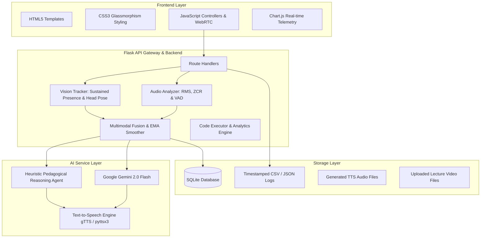

# ⚡ Multimodal Attendance & Engagement Agent
### *AI-Powered, Privacy-Preserving Classroom Intelligence System*

[](https://www.python.org/)
[](https://palletsprojects.com/p/flask/)
[](https://opencv.org/)
[](https://deepmind.google/technologies/gemini/)
[](#)

---

## 🎯 Executive Overview
In educational institutions and professional training environments, attendance tracking remains largely manual or limited to basic biometric systems that fail to capture meaningful engagement and participation context. 

The **Multimodal Attendance & Engagement Agent** is an end-to-end intelligent classroom solution that integrates:
1. **Computer Vision**: Continuous face detection, sustained presence verification, head pose, and gaze proxy tracking.
2. **Audio Signal Processing**: RMS energy, Zero-Crossing Rate (ZCR), Voice Activity Detection (VAD), and classroom acoustic dynamics classification.
3. **Multimodal Fusion Engine**: Dynamic, temporally smoothed engagement scoring ($E(t)$).
4. **Agent-Based Pedagogical Reasoning**: Google Gemini 2.0 Flash paired with an edge offline decision-support engine generating real-time teaching suggestions, pacing adjustments, and on-demand interactive concept checks.

Designed with ethical deployment at its core, the system can operate **100% offline and locally**, ensuring student privacy and zero data leakage, with optional Google Gemini cloud acceleration.

---

## 🏗️ System Architecture



---

## 🚀 Key Scenarios Addressed

### 1. Scenario 1: Automated Attendance Tracking
- **Sustained Presence Verification**: Rather than marking attendance on a single transient frame, the system requires continuous detection over a customizable threshold ($T \ge 3.0$ seconds). This eliminates false positives caused by passersby or momentary glances.
- **Timestamped Audit Logs**: Automatically captures first seen timestamp, continuous duration, and instantaneous status (`PROVISIONAL` $\to$ `PRESENT`).
- **One-Click Export**: Instant CSV download for academic records.

### 2. Scenario 2: Engagement and Session Dynamics Analysis
- **Behavioral Indicators**: Continuously tracks facial orientation (Frontal vs. Looking Down vs. Turned Away), localized movement patterns, and acoustic classroom energy.
- **Multimodal Fusion Formula**:
  $$E_{raw}(t) = w_v \cdot V_{attn}(t) + w_m \cdot V_{mot}(t) + w_a \cdot A_{int}(t)$$
  Where default weights are:
  - $w_v = 0.45$ (Visual Attention Index)
  - $w_m = 0.20$ (Movement Stability Index)
  - $w_a = 0.35$ (Audio Classroom Interaction)
- **Temporal EMA Smoothing**:
  $$E(t) = \alpha \cdot E_{raw}(t) + (1 - \alpha) \cdot E(t - 1) \quad (\alpha = 0.7)$$
- **Session Dynamics**: Real-time identification of attention dips, interactive discussion peaks, and dead-air intervals via streaming Chart.js curves.

### 3. Scenario 3: AI-Driven Teaching Suggestions
- **Context-Aware Assistance**: When engagement drops below 45% or dead-air exceeds 90 seconds, the agent formulates context-aware pedagogical advice.
- **Actionable Teacher Prompts**: Supplies ready-to-speak questions (e.g., *"Turn to your neighbor for a 60-second Think-Pair-Share on this step"*).
- **Audio Feedback**: Text-to-Speech engine allows teachers or assistants to hear suggestions hands-free.
- **On-Demand Concept Polls**: Instant 1-click quiz generation for immediate active recall checks.

---

## 📂 Project Directory Structure

```
multimodal-attendance-agent/
├── app.py                     # Flask API Gateway & Server entry point
├── config.py                  # System hyperparameters, thresholds & weights
├── requirements.txt           # Python dependencies
├── README.md                  # Comprehensive architectural documentation
├── run.bat                    # One-click Windows launcher
├── modules/
│   ├── vision_tracker.py      # Face detection, sustained presence & head pose proxy
│   ├── audio_analyzer.py      # Live mic & client WebAudio RMS/ZCR acoustic analyzer
│   └── fusion_engine.py       # Multimodal fusion & dynamic engagement scoring
├── engine/
│   ├── reasoning_engine.py    # Pattern detector for drops, silence, and peaks
│   └── teaching_assistant.py  # GenAI reasoning, TTS generation & quiz dispatcher
├── utils/
│   ├── genai_utils.py         # Google Gemini 2.0 Flash + Offline heuristic fallback
│   ├── audio_utils.py         # Signal processing functions (RMS, ZCR, VAD)
│   ├── tts_engine.py          # gTTS / pyttsx3 text-to-speech engine
│   └── code_executor.py       # Safe analytics code generation & execution
├── storage/
│   ├── database.py            # SQLite session & attendance persistence
│   ├── logs/                  # Timestamped CSV attendance logs
│   ├── generated_audio/       # Cached TTS audio files
│   └── uploads/               # Recorded lecture videos
├── static/
│   ├── css/style.css          # Modern glassmorphism dark-theme styling
│   └── js/
│       ├── camera_stream.js   # WebRTC video capture + classroom simulator
│       ├── audio_recorder.js  # WebAudio API client microphone listener
│       ├── charts.js          # Chart.js streaming telemetry
│       └── app.js             # UI events, alerts, and state management
├── templates/
│   ├── index.html             # Real-time Classroom Intelligence Dashboard
│   ├── session_history.html   # Historical sessions and CSV export
│   └── settings.html          # Hyperparameters and API key configuration
└── tests/
    ├── test_vision.py         # Vision module & sustained presence tests
    ├── test_audio.py          # Audio feature extraction tests
    └── test_fusion.py         # Multimodal fusion & alert trigger tests
```

---

## 🛠️ Installation & Setup (EPIC 1)

### 1. Prerequisites
- Python 3.10+ (tested on Python 3.13)
- Windows / macOS / Linux
- Webcam & Microphone (or use the built-in virtual classroom simulator)

### 2. Install Dependencies
```powershell
pip install -r requirements.txt
```

### 3. (Optional) Configure Google Gemini API Key
To enable cloud GenAI reasoning with Gemini 2.0 Flash:
```powershell
$env:GEMINI_API_KEY="YOUR_GEMINI_API_KEY"
```
*(If omitted, the system seamlessly runs in **100% offline privacy mode** using built-in pedagogical heuristics).*

---

## ▶️ Running the Application

### Method 1: Using the Windows Launcher
Double-click `run.bat` or execute:
```powershell
.\run.bat
```

### Method 2: Direct Python Command
```powershell
python app.py
```

Then open your browser at:
👉 **`http://127.0.0.1:5000`**

---

## 🧪 Running Unit Tests
Execute the automated test suite across Vision, Audio, and Multimodal Fusion:
```powershell
python -m unittest discover -s tests -v
```

---

## 🔒 Ethical & Privacy Guarantees
- **No Cloud Face Uploads**: Raw facial imagery is processed strictly in-memory at the edge and never transmitted to external cloud servers.
- **Sustained Verification**: Prevents accidental tracking of bystanders.
- **Assistive Decision-Support**: The agent acts strictly as an advisory companion for educators without enforcing punitive automated decisions.
